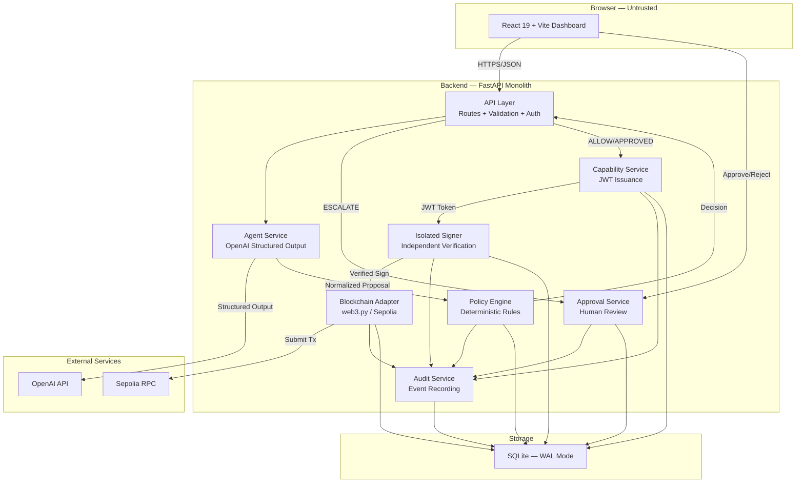
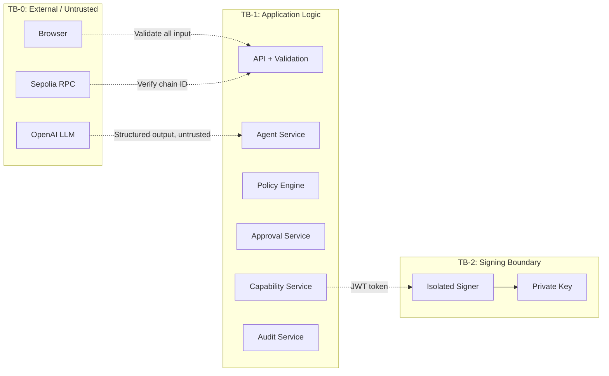
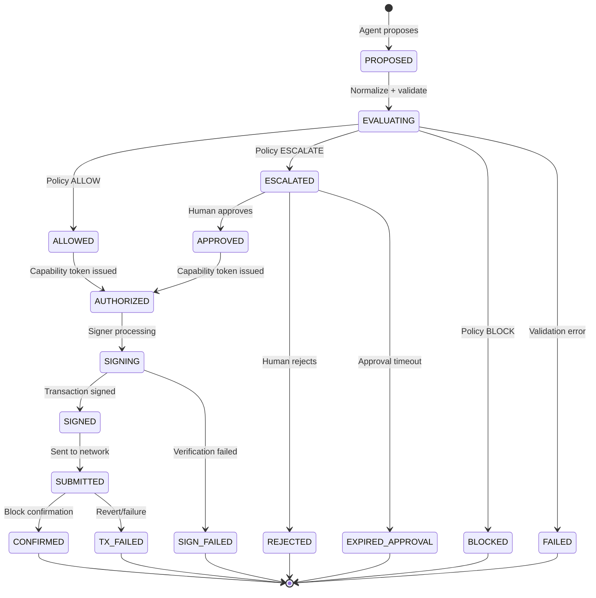

# KiteShield Wallet — Architecture

## System Overview

KiteShield Wallet implements a **constrained authorization pipeline** for AI agent-initiated blockchain transactions. The architecture follows a **modular monolith** pattern — logically separated modules within a single deployment unit.

### Core Principle
> "Give the agent hands, not the keys."

The system ensures that:
1. An AI agent can **propose** transactions
2. A deterministic **policy engine** evaluates proposals
3. A human can **approve** escalated actions
4. A narrowly-scoped **capability token** authorizes exactly one action
5. An **isolated signer** independently verifies before signing
6. An **audit trail** records the complete lifecycle

## Architecture Diagram

## Trust Boundaries

## Module Responsibilities

| Module | Responsibility | I/O | Deterministic | Security Boundary |
|---|---|---|---|---|
| API Layer | Request validation, routing, auth | HTTP I/O | No | TB-0 → TB-1 |
| Agent Service | LLM interaction, proposal normalization | Network I/O | No | TB-0 → TB-1 |
| Policy Engine | Rule evaluation, decision making | DB read | Yes* | Internal |
| Approval Service | Human review workflow | DB I/O | No | Internal |
| Capability Service | JWT token issuance | DB I/O | No | Internal |
| Isolated Signer | Token verification, tx signing | DB I/O, Crypto | No | TB-1 → TB-2 |
| Blockchain Adapter | TX submission, status tracking | Network I/O | No | TB-1 → TB-0 |
| Audit Service | Event recording | DB write | No | Internal |

*Deterministic given same input, same policy version, and same spending state.

## Transaction Lifecycle State Machine

## Blockchain Adapter: Mock RPC vs Live Sepolia

KiteShield provides two distinct execution modes via `backend/app/services/blockchain.py`:

1. **Local Simulated Mode (`mock-rpc`)**:
   - Enabled when `SEPOLIA_RPC_URL` contains `mock-rpc` (e.g. `https://mock-rpc.sepolia.org`) or `APP_ENV=test`.
   - The isolated signer re-verifies all parameters, checks token claims, consumes the token atomically, and signs the raw EIP-155 transaction using the configured testnet private key.
   - The broadcast step returns a deterministic mock hash prefixed with `0x`, tagged as `network: "sepolia-mock"`, and recorded in audit logs.
   - Ideal for local visual testing, automated CI runs, and developer onboarding without testnet gas dependencies.

2. **Live Ethereum Sepolia Mode**:
   - Enabled when configured with a real JSON-RPC provider (e.g. Alchemy, Infura, or PublicNode).
   - Pre-signed raw transaction bytes are submitted to Ethereum Sepolia (Chain ID `11155111`) via `w3.eth.send_raw_transaction`.
   - Requires the signer account to hold Sepolia testnet ETH for gas fees.

## Related Documentation

- [API Contract & Module Boundaries](API_CONTRACT.md)
- [Team Workflow & Engineering Standards](TEAM_WORKFLOW.md)
- [Work Breakdown & Independent Workstreams](WORK_BREAKDOWN.md)
- [Security Threat Model & Invariants](SECURITY.md)

## Architecture Decision Records

- [ADR-001: Modular Monolith](DECISIONS/ADR-001-modular-monolith.md)
- [ADR-002: SQLite for MVP](DECISIONS/ADR-002-sqlite-for-mvp.md)
- [ADR-003: HS256 Capability Tokens](DECISIONS/ADR-003-hs256-capability-tokens.md)
