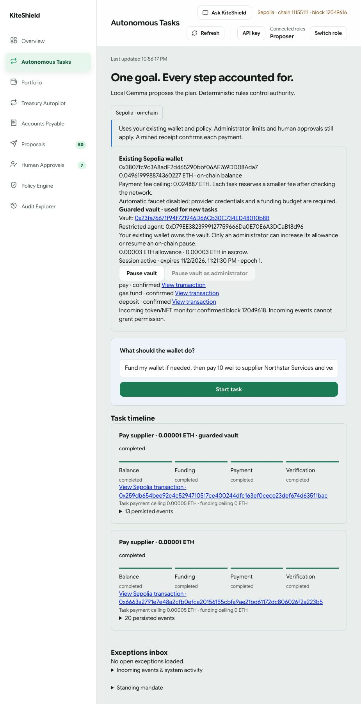

# KiteShield integration report — 2 November 2026

The main application at **http://localhost:3000** uses the existing wallet and
settings, with the durable Gemma orchestrator, local voice, incoming-event
observer and guarded-vault integration enabled. New tasks use the Sepolia vault;
historical native tasks retain their original payment method.

## Real on-chain result

One submitted sentence completed planning → balance → funding check → vault
payment → receipt verification with **no intervening clicks, approvals, retries
or operator recovery after submission**. Local Gemma proposed the four typed
steps; deterministic code chose the saved vendor and exact amount. Funding was
**skipped because the escrow was already funded**. This does not demonstrate a
successful automatic faucet request.

- Task: `4123c4e3-4761-45d6-9527-0717921a8a6b`, all four steps completed.
- Paid **0.00001 Sepolia ETH** to the existing recipient ending **e811**.
- [Confirmed payment](https://sepolia.etherscan.io/tx/0x259db654bee92c4c5294710517ce400244dfc163ef0cece23def674d635f1bac), block 12,049,492.
- [Guarded vault](https://sepolia.etherscan.io/address/0x23fa76671f94f721946D66Cb30C734ED48010b8B).
- Existing owner: `0x3807fc9c3A8adF2d465290bbf06AE769DD08Ada7`.
- Restricted agent: `0xD79EE3823999127759666Da0E70E6A3DCaB18d96`.
- Initial escrow/allowance **0.00004 ETH**; **0.00003 ETH** remained after payment.
- Total durable payment budget remains **0.00005 ETH**, including the earlier
  native transfer. Restart does not reset this budget. Sessions expire within
  one hour and can only be renewed by an administrator.

The earlier native orchestrator payment also confirmed, but required pre-signing
recovery and read-only receipt reconciliation during debugging. Its evidence
retains that distinction; it was never resent.

## Feature status

| Feature | Status and limits |
| --- | --- |
| Durable planner, typed steps, restart recovery, budgets, idempotency and timeline | Implemented; new vault goal verified on real Sepolia |
| Vault signing, exact-call capabilities, fixed recipient, allowance, expiry and nonce | Implemented and deployed; independent signer checks retained |
| Owner controls, recovery and agent tightening | Implemented; Solidity/backend tests cover them; recovery/tightening were not exercised against funded live state |
| Human escalation, task-only pause, rejection and resume | Implemented and tested with isolated roles/databases; not claimed as a live escalated payment |
| Self-quarantine and administrator-only resume | Implemented and tested; optional restriction-only on-chain pause is wired, but not deliberately triggered live |
| Incoming token/NFT observer | Enabled on the configured RPC; permission-like events cannot grant authority; attack cases use synthetic fixtures |
| Push-to-talk local whisper.cpp | Implemented and enabled; pinned public WAV transcribed locally; browser microphone capture remains unverified |
| Automatic faucet funding | Implemented adapter/workflow, **not activated**: CDP credentials are still absent, faucet disabled and funding budget zero. User is configuring credentials server-side |

The vault enforces session boundaries on-chain. Human approval of an individual
proposal is enforced by the backend signer, not independently by this contract.
Keys remain in one backend process with logical separation. The implementation
has not received an independent audit and is not approved for mainnet.

Automatic escrow funding is separately off by default. Activation requires
`AUTONOMY_VAULT_FUNDING_ENABLED`, the exact deployed vault in `WATCHED_ADDRESSES`,
the existing configured faucet, CDP credentials, a grant ceiling and a funding
budget. The agent cannot register a target or increase its allowance. A funded
owner balance is not mistaken for vault escrow; existing unknown requests are
reconciled even when escrow becomes sufficient. Agent gas remains an administrator grant.

## Verification and evidence

- Full backend suite: **771 passed, 14 skipped**, including all **32 vault tests**.
  Skips are opt-in live Horizon/Bastion model checks.
- Frontend: **89 passed**; production build and lint passed.
- Foundry: **13 passed**, including 256 cap fuzz cases.
- No new full-suite runs or extra live payments are required for this report.
  Unit/integration tests used public fixture keys and isolated databases.
- The live deployment required a separate owner gas cap; the first preflight
  correctly stopped before signing. Agent gas and cumulative fee budgets were
  not expanded by the agent. See the scoped integration design note.

Public receipts, operation bindings and task events are in
`backend/demo_autonomy/reports/guarded-vault-sepolia-2026-11-02.json` and
`guarded-vault-goal-2026-11-02.json`. Native and voice evidence have separate
reports in the same directory. Private keys, API credentials and runtime databases
are excluded from Git. Test pass counts and this single live goal are not
statistical accuracy estimates; historical committed simulated evaluations do
not establish current live reliability or live attack detection accuracy.

See [vault design and authority boundaries](GUARDED_VAULT_INTEGRATION_2026-11-02.md).

Final application source is saved on **local `main`**. A post-restart read-only
check confirmed one vault payment, contract nonce 1, the same completed task,
its committed budget claim, valid core audit chain and unchanged non-vault
configuration. No second payment was sent. The restart record is
`backend/demo_autonomy/reports/main-vault-restart-2026-11-02.json`.

