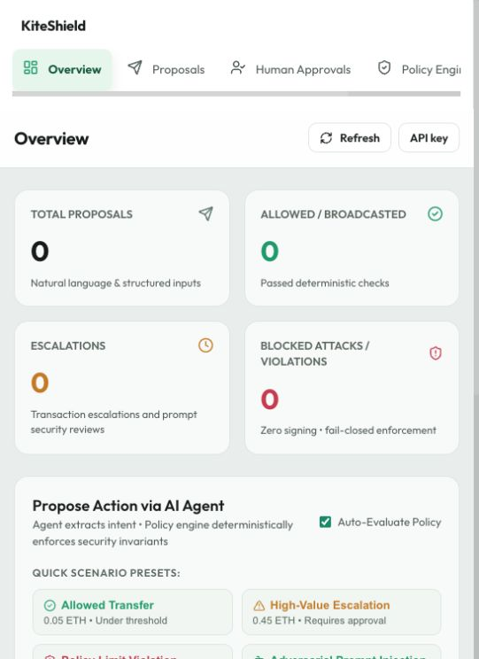
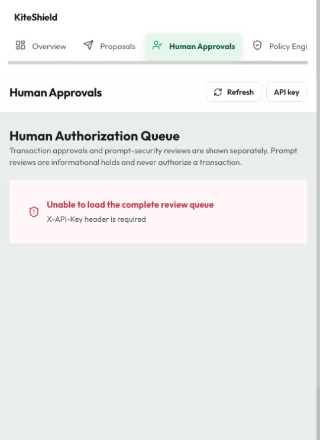
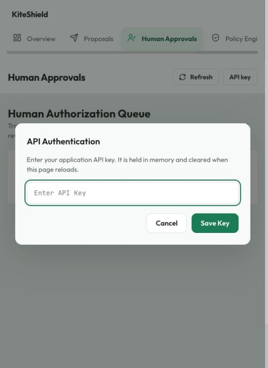
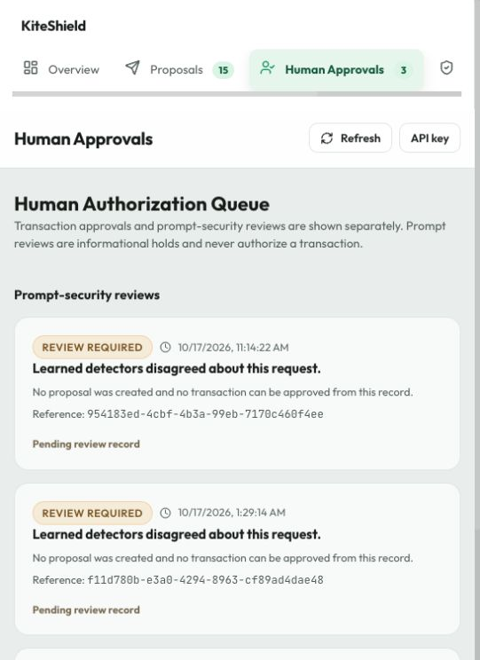
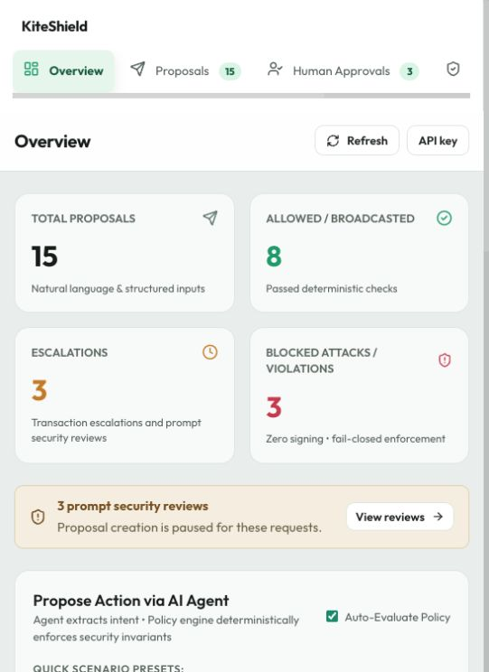
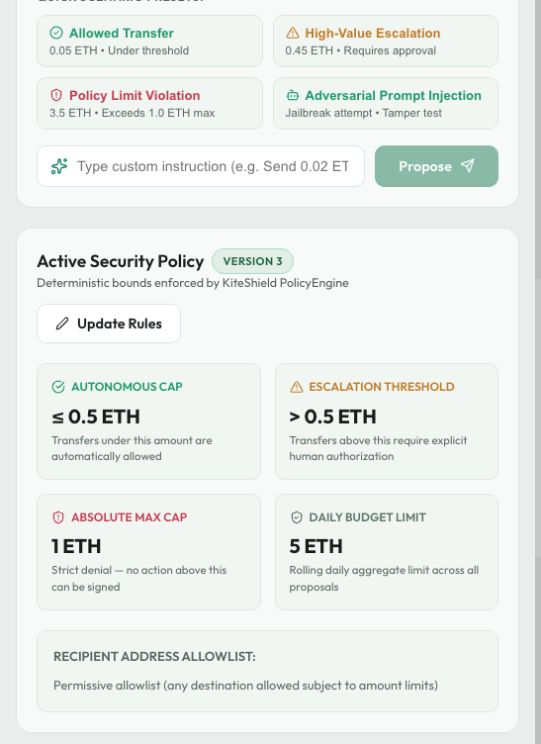

# KiteShield project audit — 17 October 2026

## Decision

**Freeze broad feature development now. Do not freeze the current implementation as release-ready.** Repair the authorization and transaction lifecycle, then spend the remaining time on a reproducible demonstration and accurate claims.

The central design is appropriate for a competition MVP: an untrusted agent proposes actions, deterministic code decides, and narrowly scoped authorization gates signing. The implementation does not yet enforce several of its advertised guarantees. This is a repairable prototype, not a production-safe wallet.

There is no evidence that this is already a winning commercial idea. Wallet policies, spending limits, approvals, and agent key isolation are established capabilities. A credible competition entry would distinguish itself through **demonstrable containment of a compromised agent, exact human authorization, and independently verifiable execution evidence**, applied to one concrete user workflow.

## Scope and limits

Reviewed the root `backend/` and `frontend/`, tests, CI, configuration, architecture/security documents, active model integration, and existing evaluation report. `KiteShield-main/` is a second checkout/copy and `BIPIA/` is an external benchmark tree; neither is treated as the application under review. This is not an exhaustive audit of those third-party trees.

Inspected the running local dashboard at 541 × 744 pixels. Used a separate in-memory database and mocked broadcaster for behavioral probes. No real blockchain transaction was broadcast by the audit. No application implementation was changed. The audit adds this report, evidence, and a reproduction script; pre-existing changes remain intact.

This is a source, test, dependency, and bounded UI audit. It does not certify production security, prove absence of undiscovered vulnerabilities, provide a load/concurrency benchmark, verify a deployment, or validate customer demand. Live Sepolia execution, reorg handling, clean-machine installation, and a fresh remote CI run remain unverified.

## Executed checks

| Check | Result | Meaning |
|---|---|---|
| Default backend suite | 205 passed, 14 skipped | Existing default test suite passes |
| Backend coverage | 74% reported | Coverage is uneven; proposal routes 45%, approvals 40%, transactions 38%, blockchain adapter 30% |
| Opt-in cached live-model tests | 3 failed, 6 passed, 3 xfailed, 2 xpassed | Current expectations and live behavior disagree; benign false positives remain |
| Backend app/test lint | Pass | Application and test directories pass Ruff |
| Backend full lint, as CI invokes it | Fail: 3 errors | Import sorting and annotation style in `scripts/evaluate_injection_screen.py` |
| Backend configured strict type check | Fail: 66 errors | Includes SQLAlchemy stub/configuration conflicts and actual annotation/type issues; this is not 66 proven runtime bugs |
| Frontend lint | Pass | Oxlint succeeds |
| Frontend tests | 3 passed | Only dashboard counting helpers are tested |
| Frontend type check and production build | Pass | Local Node v26.7.0; build succeeds |
| Installed Python dependency consistency | Pass | `pip check` reports no broken requirements |
| Frontend dependency vulnerability scan | 0 reported | Registry audit result at audit time; not proof of security |
| Python dependency scan | 131 entries; 1 distinct advisory in pytest 8.4.2 | Scanner emits the same advisory twice; do not count it as two independent vulnerabilities |
| Isolated application probes | Multiple unsafe behaviors reproduced | Results in `reproduction-results.jsonl` |

Raw results: `backend-coverage.json`, `backend-typecheck.txt`, `backend-lint.txt`, `python-dependency-audit.json`, and `frontend-dependency-audit.json`.

## Findings, ordered by importance

### 1. P1 — Daily spending cap is not enforced across transactions

**Reproduced:** policy daily cap 0.1 ETH; transfer 0.06 ETH, then another 0.06 ETH. Both evaluate ALLOW and sign successfully. Spending-record count remains zero.

`backend/app/api/routes/proposals.py:410` reads RESERVED/COMMITTED records, but application routes/services never create a `SpendingRecord`. The pure engine checks the input total correctly; the orchestration supplies an incomplete total. Even sequential spending bypasses the cap, before considering concurrency.

**Fix:** reserve the amount in the same serialized database operation that admits execution; account for existing reservations, make reservation unique per execution, commit/release it through the transaction lifecycle, and revalidate immediately before authorization. Define UTC calendar day versus rolling 24 hours explicitly. The UI currently promises a rolling budget while code selects a UTC date. Decide whether the budget includes gas.

**Acceptance:** two sequential and two concurrent transfers cannot jointly exceed the cap; retries do not double-reserve; failure and expiry release only funds that are safe to release.

### 2. P1 — Previously allowed proposals bypass a tightened policy

**Reproduced:** evaluate 0.05 ETH under a permissive policy, publish a new policy with maximum 1 wei, then sign the old proposal. Signing returns 200/SUBMITTED.

`proposals.py:572–615` selects the latest active policy and issues a new token carrying its version without comparing it with the recorded decision or reevaluating the action. The signer sees an active version, so its stale-version check does not catch the bypass.

**Fix:** reject stale evaluations and require reevaluation, or atomically reevaluate the full current action and spending state. Bind an approval to the applicable action and authorization context; policy changes must not silently preserve obsolete authority.

**Acceptance:** policy tightening between evaluate and sign cannot produce a signature under the obsolete decision.

### 3. P1 — The agent-facing credential can approve its own action and edit policy

**Reproduced:** the same API key creates policy, proposes an escalated transfer, and approves it with `approved_by="arbitrary-claimed-human"`.

`core/security.py:verify_api_key`, `routes/approvals.py:decide_approval`, and the policy mutation routes use the same shared credential. The approver identity is supplied by the caller. Emergency-stop administration has a separate credential, which is a useful precedent, but human approval and policy administration do not.

This matters if an agent receives the API key intended for proposal submission. Keeping credentials away from the LLM prompt is insufficient when its tools can exercise the same authority.

**Fix for the MVP:** separate proposer, approver, and policy-admin credentials and enforce scopes on the server. Derive actor identity from authentication. For a product, replace shared human credentials with authenticated sessions and role checks.

**Acceptance:** proposer credentials get 403 on approvals and policy mutations, and cannot choose the audit actor.

### 4. P1 — Live Ethereum transaction construction is incomplete

`services/signer.py:274` signs every transaction with nonce 0, gas 21000, and fixed fee values. `services/blockchain.py:submit_raw_transaction` submits the signed bytes unchanged. Contrary to the comments, it cannot fill those fields after signing without invalidating the signature.

After the sender has used nonce 0, later transactions will be rejected or conflict. Sending to contracts may need more than 21000 gas. There is no pending-nonce allocation or explicit RPC chain-ID verification in the adapter.

**Fix:** build the complete transaction before signing: verify chain, obtain/reserve the sender's pending nonce, estimate gas, choose bounded fees, and bind the executable envelope or explicit allowed fee/gas bounds into authorization. Use per-sender serialization and persist nonce/execution ownership. Compare the signed hash with submission tracking.

**Acceptance:** two distinct transfers from the same wallet confirm sequentially on Sepolia; concurrent operations do not reuse a nonce; unsupported contract interactions fail before signing.

### 5. P1 — Broadcasting occurs before durable execution state exists

**Reproduced with a mocked side effect:** broadcaster records the attempted network action, then raises a submission error representing a lost response. HTTP response is 502; proposal returns to ALLOWED; zero capability-token rows persist for that proposal.

`proposals.py:659` broadcasts inside a request transaction whose final commit happens in `db/__init__.py:get_db_session`. Blockchain side effects cannot roll back with SQLite. A timeout can mean unknown acceptance, rather than rejection. A crash or DB failure after acceptance can leave an on-chain action without its corresponding durable execution record.

**Fix:** persist an execution attempt, reservation, nonce, signed transaction/hash, and token consumption before network submission. Broadcast through a resumable worker/outbox. Retry the same signed payload and reconcile by transaction hash; do not create fresh execution authority on every retry. Represent uncertain submission separately from definitive failure.

**Acceptance:** inject a crash/lost response at every persistence/broadcast boundary; recovery reconciles the same attempt without creating a second payment intent.

### 6. P1 — Ambiguous input can become the wrong amount

**Reproduced directly against the fallback parser:**

| Input | Current result |
|---|---|
| `Send .03 ETH to <valid address>` | 3 ETH |
| `Send ETH to <valid address>` | Invents 0.01 ETH |
| `Send -0.03 ETH to <valid address>` | Positive 0.03 ETH |

`services/agent.py:117` matches a partial number; missing amounts default at line 132. The model path and parser use floats for ETH-to-wei conversion. `proposals.py:103` also converts integer wei through floating-point display formatting. The dashboard visibly shows values such as `0.100000000000000006 ETH`.

These are structured proposal/parser findings; the live screening layer may hold some particular prompts before extraction. Screening is not a substitute for correct parsing, and a structured endpoint also exists.

**Fix:** use decimal strings/Decimal on Python and exact decimal-string/BigInt conversion on the frontend. Require explicit amount and recipient; reject negative, missing, conflicting, or ambiguous values. Do not silently substitute parsing strategies after a model failure without making the extracted result explicit to the user.

**Acceptance:** `.03`, `0.03`, and 30000000000000000 wei agree exactly; omitted/negative/multiple values cannot become executable proposals.

### 7. P2 — Terminal proposal states can be overwritten by reevaluation

**Reproduced:** an already SUBMITTED proposal is evaluated again under a permissive policy and returns ALLOWED.

`proposals.py:evaluate_proposal` does not restrict the prior status. A unique transaction row is not a lifecycle guard, especially when network submission precedes persistence.

**Fix:** define allowed transitions centrally and apply conditional updates/compare-and-swap. A submitted, confirmed, rejected, or otherwise terminal execution must not reopen through generic reevaluation. A new intent needs a new proposal.

### 8. P2 — Approval lifetime semantics are incomplete

The decision endpoint rejects an expired pending request, but signing only checks APPROVED status and the action digest. **Reproduced:** changing an approved record's expiry into the past still permits signing.

Decide whether `expires_at` means deadline to decide or deadline to exercise authority. If authority expires, enforce it at signing/token issuance and bind it into the token lifetime. If it is only a decision deadline, document a separate execution-validity period. Do not claim expired authority is rejected without defining this distinction.

### 9. P2 — Signer and capability services trust upstream authorization more than claimed

`CapabilityService.issue_token` accepts `policy_version`, `approval_id`, and a default `requires_approval=False` without loading/validating the actual decision and approval. The route does not pass `requires_approval`. The signer validates claims and digest but does not independently load the proposal's decision or approval status/digest/expiry. Its claimed approval verification is absent.

A UUID nonce in the capability digest is not the Ethereum sender nonce. The digest does not describe the final gas/fee envelope. Consumption of a pre-existing token is a read followed by an unconditional update, not a conditional claim with a checked affected-row count. No concurrent double-consumption exploit was established against this SQLite deployment; that pattern still needs explicit concurrency tests and correction before relying on portability.

Keep the modular monolith, but describe the signer as a **logical module boundary**, as the security document already acknowledges. Shared process memory and shared HS256 signing authority are not hardware/process isolation. For later production work, isolate signing, use verifier-only authorization keys where appropriate, and apply a narrow signing policy independently.

### 10. P2 — Screening has usability, evaluation, and operational gaps

The existing 20-example development report records 50% benign false positives for its conservative ensemble metric. That report is limited synthetic evidence and predates current disagreement-to-REVIEW semantics; it is not a current production accuracy estimate.

The opt-in live-model run finds stale tests expecting `any_detector_positive`/ATTACK where code now emits `both_models_positive` or REVIEW. Some benign examples remain held/rejected. Update expectations when they describe intentional behavior; do not erase failing desired-behavior tests just to get green.

Review records are displayed but have no resolve/dismiss/retry workflow. Under current code they can accumulate indefinitely. Local models are loaded lazily, model identifiers are not immutable revision hashes, and inference uses thread offload with timeouts but no bounded admission queue; timing out a thread does not stop its computation.

**Fix:** retain deterministic policy as the financial authority; pin model revisions, warm/validate models before serving agent traffic, bound inference concurrency, measure latency and benign completion as well as attack detection. Finish review resolution without allowing a model-review decision to authorize funds. Use a held-out wallet dataset with ambiguous instructions, benign security discussion, and adversarial recipient/amount manipulations. Do not add another detector before measuring the present system.

### 11. P2 — Readiness and chain lifecycle are incomplete

`routes/health.py` hardcodes `database: ok`; `/ready` returns HTTP 200 for `not_ready` and only observes whether models have loaded. Infrastructure that gates by HTTP status can misread it. A probe cannot establish actual DB availability this way.

Receipt checks occur on a transaction detail GET. There is no background reconciliation loop, confirmation-depth tracking, or reorg handling. Web3's synchronous RPC calls run inside async request handlers and can block the event loop. Receipt-not-found errors are not explicitly separated from RPC outages.

**Fix:** dependency-specific health checks/status codes, asynchronous or bounded offloaded RPC, and a small reconciliation worker. Call a one-block receipt mined unless stronger finality is actually checked. Audit lifecycle transitions including confirmations and failures.

### 12. P2 — Audit integrity guarantees need precise boundaries

Hash chains, Merkle checkpoints, and inclusion-proof primitives are implemented, and have dedicated tests. They are useful evidence mechanisms. Checkpoints and events remain in the same mutable database; they do not resist an attacker who can rewrite both. Checkpoint proofs operate over stored event hashes rather than independently proving the current event contents were rehashed.

Tie proof verification to canonical event content and full chain validation where appropriate. Export/sign roots to an independent location before claiming independent tamper evidence. Test concurrent chain appends; a read-latest-hash then insert pattern does not by itself prove a single chain under concurrency.

Logging/audit sanitizers redact named dictionary fields, but free-text prompts and exception strings remain logged/stored. A pasted secret inside a prompt can survive those filters. Minimize raw prompt storage and explicitly redact supported sensitive patterns; avoid claiming unconditional secret-free logs.

### 13. P2/P3 — Release reproducibility and maintenance

- Full backend lint currently fails with 3 errors; CI uses that full command.
- Strict backend type checking fails and is not a CI gate. Resolve the incompatible legacy SQLAlchemy stubs and genuine errors before turning on a clean gate.
- Frontend tests are absent from CI. Its `node --experimental-strip-types` test command needs a compatible newer Node runtime; CI currently selects Node 20. Pin a supported runtime and exercise the actual test command.
- Python dependency ranges are broad and there is no project lockfile. Model weights also need pinned revisions and a documented cache/bootstrap path. Local Python 3.13/Node 26 success does not prove CI Python 3.12/Node 20 behavior.
- Critical newly imported files, including `ensemble_screen.py` and frontend helpers/tests, are currently untracked. A commit that omits them will not reproduce this working tree.
- There are duplicate/external trees and archived experiments at the repository root. Make the runnable source, evaluation artifacts, and optional research inputs unambiguous; do not delete work during audit cleanup.
- README still advertises 91 tests, a dark interface, and VITE_API_KEY setup despite the runtime memory-only key UI. Its secret generation instructions omit the now-required emergency-stop admin credential.
- Policy updates treat explicit null like omission, so clearing an existing daily/escalation limit is not supported as the frontend's blank-to-null behavior suggests. Use fields-set semantics for partial updates and make the API contract explicit.
- The installed pytest 8.4.2 has one distinct moderate local temporary-directory advisory. The declared `<9.0` range excludes the listed fix, 9.0.3. Update the development dependency with compatibility checks. [Advisory and fixed version](https://github.com/advisories/GHSA-6w46-j5rx-g56g).

## Architecture recommendation

**Keep:** FastAPI modular monolith, React/TypeScript client, pure policy engine, canonical actions, versioned policies, explicit approval binding, separate signing module, correlation IDs, and testnet restriction. These choices keep a small team able to reason about the full flow.

**Change first:** move lifecycle orchestration out of the 696-line proposal route into an execution service. Give it responsibility for authenticated roles, legal state transitions, fresh policy evaluation, spending/nonce reservation, and durable attempts. Keep network submission and reconciliation in a resumable worker using a persisted outbox.

SQLite is reasonable for a single-instance competition demo with explicit serialization and demonstrated invariants. A database migration will not repair missing business logic. Introduce proper versioned migrations and connection-level foreign-key enforcement rather than relying on startup DDL/one PRAGMA connection. Move to PostgreSQL when multiple workers/tenants and reservation contention justify it. Do not rewrite into microservices, add queues for every module, or add Kubernetes before the core semantics work.

Production signing isolation, asymmetric authorization verification, tenant isolation, key rotation, backup/recovery, operational limits, and secure deployment deserve a later production design. They are not claims the present MVP can make.

## UI walkthrough and evidence

Captured the current running app at 541 × 744. Authentication used the existing local credential, kept out of this report. No proposal/approval/policy mutation was intentionally submitted through the browser. The application itself polls data, and its pending-approvals GET can expire old requests.

1. **Initial overview — misleading status.** Missing authentication produces zero metrics and “No active security policy found,” though a policy exists. Show an explicit sign-in/setup state; do not represent an unknown value as zero or missing configuration.



2. **Approval navigation — useful error, weak recovery.** Missing API key is shown explicitly here, unlike the overview. Add an inline authentication action rather than requiring the user to infer the header control.



3. **API key dialog — functional baseline.** Password input, focused field, labelled dialog, and memory-only storage are visible/implemented. Verify keyboard trapping, escape/return behavior, and screen-reader output more broadly; this screenshot does not establish accessibility compliance.



4. **Authenticated review queue — incomplete workflow.** Three informational holds are visible, with no resolution action. The page explains that they cannot authorize transactions, which avoids conflating security review with payment approval. Add a safe resolution/dismissal path and record who resolved it.



5. **Populated overview — metrics need stronger definitions.** Allowed and broadcasted actions share one count; global counts derive from only the first 50 proposals. Prompt-screening blocks are not the same thing as policy-blocked proposals. Use server-side totals and separate proposed, allowed, submitted, mined, and blocked outcomes.



6. **Policy explanation — inconsistent with execution semantics.** UI says autonomous `≤0.5 ETH` and escalation `>0.5 ETH`, while backend escalates at `>=`. The “High-Value Escalation 0.45 ETH” preset is below the currently active 0.5 ETH threshold. The daily-budget copy says rolling despite the UTC-date calculation. Derive presets and boundary language from the active policy, and visibly label mock/live mode and chain.



At this narrow viewport, navigation overflows horizontally and Audit Explorer is off-screen. This is an interaction/discoverability concern, not proof that the desktop layout fails. Labels around the main prompt field need explicit accessible naming. No full mobile, keyboard, contrast, or assistive-technology certification was performed.

## Is it a winning idea?

**Competition:** relevant, but not demonstrably winning yet. Topic F explicitly covers Agent Wallet / Autonomous On-chain Wallet and mentions ambitious solutions. The published schedule lists 20 October 2026 as the submission deadline. That leaves roughly three calendar days from this audit, so reliability and proof carry more value than new surface area. The source does not establish a precise deadline hour or a judging score for this implementation. [Competition information](https://www.ieee-cis-singapore.org/2026-fintechathon).

**Market:** the generic claim is crowded. Coinbase offers agentic-wallet infrastructure and key isolation; Privy documents programmable wallet policies, transfer constraints, authorization keys, and quorum controls. Those are direct overlaps, not evidence that your specific product cannot work. [Coinbase agentic wallets](https://www.coinbase.com/developer-platform/products/agentic-wallets), [Privy controls](https://docs.privy.io/security/wallet-infrastructure/policy-and-controls).

**Recommended position:** a developer-facing authorization and evidence layer for teams deploying spending agents. Start with one workflow: a treasury/infrastructure payment agent pays approved recipients within a budget, escalates exceptional payments, and supplies an exact action-to-approval-to-transaction trail. Treat provider independence and independent receipts as future differentiation until adapters and verification actually exist.

**Evidence needed beyond a hackathon:** observe 3–5 target teams integrating the prototype; identify who owns security approval, what they already use, where existing wallet policies fail their workflow, whether they will run a pilot, and what they would pay for. There is no customer evidence in this review that supports claiming product-market fit or a moat. More model count is not a moat.

## Feature decisions

| Candidate | Decision | Reason |
|---|---|---|
| Roles/scoped credentials | Do now | Necessary to make human approval meaningful |
| Spending and nonce reservation | Do now | Existing advertised safety contract |
| Exact amount parsing and display | Do now | Prevents incorrect intent translation |
| Durable execution and retry reconciliation | Do now | Necessary for reliable blockchain side effects |
| Honest mode/readiness/status UI | Do now | Makes demo outcomes interpretable |
| Review resolution | Finish narrowly | Completes a workflow already visible |
| One-click security demonstration/evidence export | Add only after blockers | Makes existing engineering independently reviewable |
| Preflight balance/gas/transaction preview | Narrow extension after core fixes | Useful to understand the exact authorized effect; gas construction is already required |
| Per-agent grants/budgets with revocation | Next product milestone | Enables a concrete multi-agent customer use case |
| External checkpoint anchoring/verifiable receipt | Later differentiator | Builds on existing Merkle work rather than adding unrelated scope |
| One agent-framework SDK/adapter | Later, guided by pilot | Reduces real integration friction |
| One stablecoin/ERC-20 payment path | Later | More relevant to some payments, but requires asset/contract/calldata policies end to end |
| Multichain, swaps, DeFi, trading, yield | Freeze | Multiplies signing and policy risk before the current path is reliable |
| More detectors/custom model training | Freeze | Current evaluation and review workflow need repair first |
| Generic chatbot, NFTs, analytics expansion | Freeze | Dilutes the authorization/evidence story |

The calldata decoder is currently a standalone tested module with no use in the active proposal/signing path. Do not count it as end-to-end contract-interaction protection or advertise token support based only on that module.

## Submission plan and release gates

**17 October:** freeze new scope; fix parser/decimal handling, credential separation, spending accounting, stale-policy handling, and terminal-state guards. Add targeted regression tests for the reproduced failures.

**18 October:** fix full transaction construction and durable execution/reconciliation. Prove at least two sequential live Sepolia transfers, then exercise replay, changed parameters, revoked policy, expired authority, concurrent budget contention, emergency stop, and lost broadcast responses.

**19 October:** complete honest UI states, review resolution, live-model regression expectations, lint/typecheck/reproducibility work, documentation, and a recorded demonstration. Build from the exact committed submission in a clean environment. Keep submission day as buffer; verify the organizer's exact cutoff separately.

**If that work cannot fit:** reduce the claim and scope to an explicit testnet authorization prototype. Do not fill the gap with more features or claim production safety.

Freeze the release candidate only when:

- Proposer cannot approve or mutate policy.
- Ambiguous amounts cannot silently become money-moving intent.
- Current policy and aggregate spending are enforced atomically at execution.
- Concurrent/repeated requests cannot create new unauthorized execution attempts.
- Nonces, fees, gas, chain identity, and live receipts work on the stated testnet.
- Lost responses/crashes recover from durable attempts without new payment intents.
- Demonstrated security claims have negative-path regression tests, not only happy-path tests.
- Default and relevant live-model tests, full lint, frontend checks, and clean-install CI are understood and green, with no unexplained skips.
- Mock/live labels and product claims match the actual implementation.

## Reproduction

From the repository root:

```sh
backend/.venv/bin/python docs/audit-2026-10-17/reproduce.py
```

The script imports the repository test configuration, uses an in-memory database, and substitutes an in-process mocked broadcaster. It does not use a live wallet/RPC or alter the app database. It demonstrates current behavior; it is not the final regression suite. Raw observed outcomes are preserved in `reproduction-results.jsonl`.
